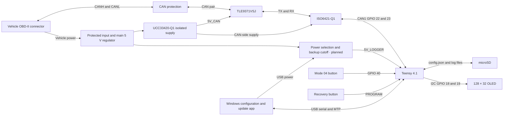
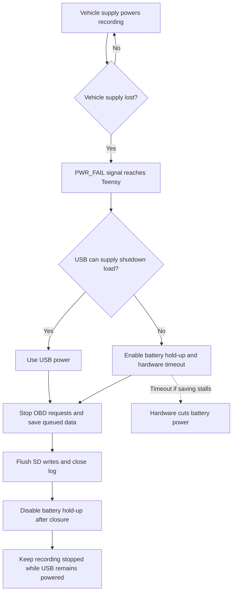
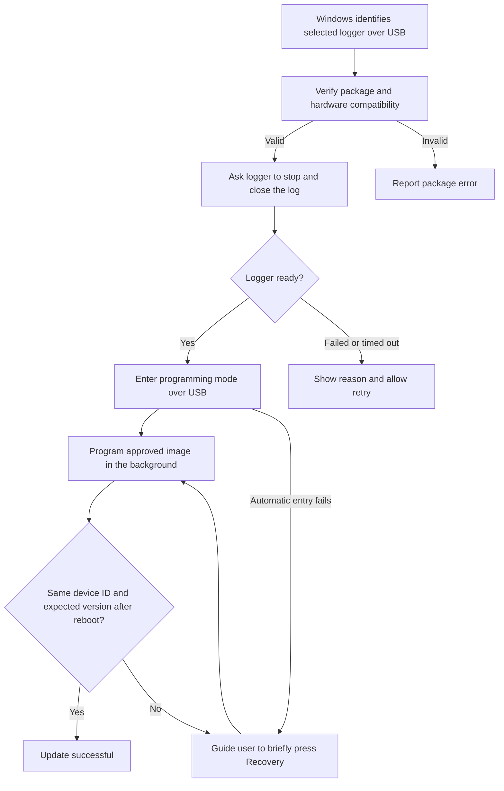
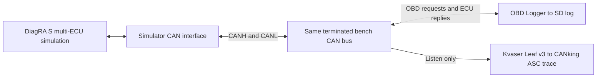

# OBD Logger design review diagrams

The diagrams combine the verified bench workflow with planned production hardware. Labels marked planned require schematic review and bench validation.

## Product overview

The isolation barrier crosses the signal isolator and isolated DC/DC converter. Keep GND_CAN and GND_LOGIC separate across it. The vehicle input return and USB power routing must be reviewed together so external wiring does not bypass the barrier. MTP exposes the SD card after recording stops and the file closes. Backup power serves log closure. RTC backup is outside the product scope.

## Power loss and shutdown

Production checks: verify that the transfer to USB or battery keeps the Teensy and SD within their supply limits. Test vehicle removal with USB present and absent. Measure peak current and worst-case time to file closure before accepting the provisional 200 ms hold-up target. Verify the independent cutoff on a stalled save. Include test points for main 5 V, logger 5 V, isolated CAN 5 V, PWR_FAIL and each local ground.

## Firmware update and recovery

Bench verified: standard-board HEX update from dev2 to dev3 without a button press or uploader window, with the same device ID and readable SD logs. Planned: package verification in the Windows app, locked-board EHEX installation and physical recovery. The current command-line uploader supports HEX. Interrupted-update automatic rollback is outside the verified design.

## CAN bench setup

Use the same simulation, JSON, bitrate and bus wiring for both firmware runs. Start CANking before restarting the logger. Align the two traces using common requests and replies. Record the firmware commit and any stop reason. The intermittent CAN receive overrun remains open.
